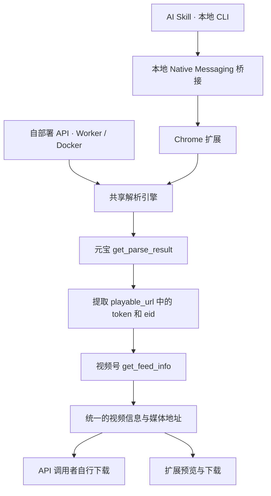

# 架构与维护说明

安装和日常使用见 [README](../README.md)，数据处理见 [隐私政策](../PRIVACY.md)。动态验收和交付状态以仓库 Issues 为准。

## 共享解析核心



共享核心使用 JavaScript / TypeScript，负责：

- 校验分享链接并检查元宝登录态。
- 构造请求、解析响应，提取 `token` 和 `eid`。
- 获取视频详情，统一媒体地址的选择规则。
- 返回稳定的结果格式，区分未登录、内容不可用和上游请求失败。

服务与扩展负责各自的登录态、请求适配；扩展还负责交互与文件下载。Skill 负责本机安装检测、桥接配置及任务调用，复用扩展的解析与下载。解析规则只在核心中维护一次。

核心入口是 `src/core.mjs`，导出 `parseShareLink(url, { request })`、`checkLogin(request)` 和 `ParseError`。`request(url, init)` 使用 Fetch 风格返回值，认证留在请求适配器中。Node / Worker 复用 `src/cookie-request.mjs`，仅向固定元宝接口发送部署者 Cookie，并拒绝重定向。

`checkLogin` 返回 `{status: "authenticated"}` 或 `{status: "anonymous"}`，格式或网络异常抛出 `LOGIN_CHECK_FAILED`。`parseShareLink` 自行检查登录，匿名或过期返回 `AUTH_EXPIRED`。结果不包含内部 `token` / `eid`。

| 核心错误 | 含义 | API HTTP 状态 |
| --- | --- | --- |
| `INVALID_URL` | 分享链接格式不支持 | 400 |
| `AUTH_EXPIRED` | 元宝未登录或需刷新会话 | 401 |
| `LOGIN_CHECK_FAILED` | 无法可靠检查登录 | 502 |
| `FEED_UNAVAILABLE` | 内容不可用或无媒体 | 404 |
| `UPSTREAM_ERROR` | 上游 HTTP、格式或协议异常 | 502 |

账号检查使用元宝 `/api/getuserinfo`。分享链接解析使用 `/api/weixin/get_parse_result`，随后调用视频号 `/finder-preview/api/feed/get_feed_info`。视频媒体地址来自详情响应中的 `h264VideoInfo.videoUrl` 等字段。

本路线按分享预览接口返回的媒体地址直接下载。内容解析失败或下载文件无法播放时，需要返回明确错误。

本地保存检查 HTTP、非空内容和已知文本错误响应；需要确认媒体有效性时，可用媒体工具或播放器检查保存文件。项目没有加入未经具体媒体证明需要的解密器。

## 扩展请求与浏览器会话

解析时无需打开元宝或视频号上游标签页。手动页面解析使用隐藏 iframe，Skill 后台解析由 offscreen 文档中的同一 iframe 请求实现承接；登录态仍由浏览器持有。浏览器按 iframe 的 SameSite 与第三方 Cookie 策略决定是否携带元宝 Cookie。受控 Chrome 测试中，未分区的 HttpOnly `SameSite=None` Cookie 随请求发送，未分区的 HttpOnly `SameSite=Strict` Cookie 未发送，因此不能保证依赖后者的登录态可用。

视频详情 API 由扩展 service worker 直接请求。扩展临时添加一条仅匹配核心生成的固定 API URL、当前扩展发起的 POST/XHR 请求的 session DNR 规则，为该请求设置视频号 `Origin` 和完整 `Referer`，完成后删除规则。请求使用核心生成的 `_rid`、`_pageUrl`、请求体和含 `token`、`eid` 的 Referer，不携带视频号 Cookie；页面消息只接受扩展自己的 `index.html`，后台 Skill 任务复用同一请求校验，核对 API、页面参数和请求体彼此匹配。此功能需要 Chrome 116+、`declarativeNetRequestWithHostAccess` 权限及视频号站点访问权限。扩展不读取 Cookie，也不会回退到上游标签页。实际 Chrome 扩展解析、预览与下载验收见 [产品目标 #10](https://github.com/MC0571/weixin-channels-video/issues/10)，Skill CLI 与 Native Messaging 下载验收见 [产品目标 #4](https://github.com/MC0571/weixin-channels-video/issues/4)。

扩展申请下载、`declarativeNetRequestWithHostAccess`、与本地桥接通信的 `nativeMessaging` 及访问两个上游站点所需的 host permissions。后台用 `storage` 保存实例 UUID、登录 snapshot、连接阶段和固定错误类别，`offscreen` 承接隐藏 iframe，`alarms` 定期刷新登录 snapshot 并恢复桥接连接；页面只读取并显示许可状态值，不显示 `runtime.lastError` 原文。host 的 Native Messaging `ready` 只确认 host 已启动；CLI 通过带 IPC HMAC 认证且收到扩展 status 响应的完整往返确认实例健康。升级时核对这些权限。元宝登录凭据留在浏览器端，不发送给项目提供的第三方解析服务。

扩展复用 Chrome 会话发请求，没有 `cookies` 权限。默认保存到 Chrome 下载目录，重名时自动改名；位置选择遵循 Chrome 自己的下载设置。页面显示下载完成或中断。Chrome 下载 API 会按浏览器规则向媒体主机携带该主机已有的 Cookie，不能通过此 API 设置 `credentials: omit`。[Chrome 下载 API 文档](https://developer.chrome.com/docs/extensions/reference/api/downloads#method-download)

## Skill 运行资源与桥接

Skill 使用外部 Node.js 运行。普通 Skill 用户最低 Node.js 版本是 22.22.2，由 `skills/weixin-channels-video/scripts/runtime-support.mjs` 提供；开发、测试和 Worker 构建工具要求 Node.js 24+。实际 Agent、OS、Shell、架构、运行位置和 Chrome 可达性见 [Agent 安装说明](../skills/weixin-channels-video/references/agent-installation.md)。Skill 页面流程只写共享操作；宿主导入、Windows/WSL 以及扩展安装方式由该 reference 维护。

从仓库安装的 Skill 通过 `scripts/run.mjs prepare` 从稳定 `skill-v…` Releases 选择运行资源，校验 SHA256、归档路径、runtime protocol 及最低 Node 版本后缓存。扩展 Release 不提供 Skill 资源；没有兼容 Skill Release 时准确停止并保留已有缓存。独立 Skill Release 包含运行资源，可离线准备。Skill 包含 CLI、Native Messaging host 和运行资源，不含 Chrome 扩展。CLI / host / 扩展版本仅用于追溯，兼容性由运行资源、Native Messaging wire 和 IPC 协议契约决定。运行资源 protocol 3、Native Messaging wire protocol 2、IPC protocol 2 独立管理；IPC protocol 2 使用私有 HMAC secret。

扩展首次启动时，在自身 `storage.local` 中生成并保存稳定 UUID。每个扩展实例注册独立私有 endpoint 和 discovery record，避免多个 Chrome profile 共用一个可被错误选中的桥接状态。Native Messaging host 登记实际扩展 ID 到 `allowed_origins`，并在运行时按同一扩展 ID 校验 `origin`。实例 UUID 是本机选择标识，不是配对凭据；IPC HMAC secret 保留在用户私有存储中，不通过 Native Messaging 或 IPC 帧传输，也不写日志。

扩展 service worker 启动和持久 alarm 触发后自动发现 endpoint、连接 host 并恢复连接；扩展页面不必打开或常驻。host 和扩展的 Native Messaging wire version 为 2。Skill CLI 通过 authenticated `connections` 请求发现候选；仅收到真实 status 响应的活动实例会列出。唯一候选可为当前任务临时使用而不持久化；多个候选返回歧义。`connect --instance UUID` 用于显式选择并持久绑定，绑定后的实例离线时不回退至其他实例。未选择时不扫描 Chrome profile metadata；profile 参数只用于启动 Chrome。

扩展维护元宝登录 snapshot，字段为 `login`（`authenticated`、`anonymous`、`failed` 或 `not_checked`）、`checkedAt`（epoch 毫秒或 `null`）及可选 `error`。单一五分钟 alarm 定期刷新；打开扩展页面时即时刷新。`status` 通过扩展的真实响应确认桥接往返，并读取 snapshot，不依赖登录检查成功来证明连接。Agent 提交解析/下载任务前要求状态新鲜；未知或过期时请求扩展刷新，明确 `anonymous` 时停止业务任务，`failed` 不得误报为未登录。共享核心的 parse 登录检查仍然执行，返回 `AUTH_EXPIRED` 时扩展同步更新 snapshot 为匿名。

连接断开时 CLI 检查 Chrome 进程，状态区分 `running`、`not_running` 与 `unknown`。Chrome 已运行则复用并等待后台重连；仅明确 `not_running` 时启动一次 Chrome，不传 URL。macOS 使用 `open -g` 后台启动；Windows 使用 Chromium `--no-startup-window` 启动正常 Chrome，让扩展在无窗口状态下后台运行，不使用 headless 或远程调试。Windows 实机前台焦点行为尚未验证。检查结果为 `unknown` 时返回对应检测错误，不能按未运行处理。Skill 安装和桥接安装成功后，通过 CLI 与扩展真实往返确认后即可完成准备，不要求先登录元宝、解析或下载。

升级兼容性：旧 Native Messaging wire v1 配置仅供旧 CLI 与旧扩展路径继续使用；新 CLI 遇到旧配置时提示升级，不自动降级。新扩展遇到旧 host 时更新 bridge。扩展 ID、Chrome 用户目录和 profile 身份相同时，已有 IPC protocol 2 私有配置与 secret 在 host 更新时保留；版本号按组件实际报告。

下载仍由 Chrome 扩展执行。默认文件名来自视频标题，清理非法字符并限制长度；重名按 Chrome 规则改名。CLI 等待 Chrome 确认完成后返回最终路径、字节数与解析结果。提交任务后若断连或超时，不自动重发。临时媒体链接、Cookie、钥匙串凭据、`generalToken` 和 API 凭据不进入公共日志或对话。

## API 契约

```http
POST /parse
Authorization: Bearer <API 访问凭据>
Content-Type: application/json

{"url":"https://weixin.qq.com/sph/你的分享链接"}
```

返回统一的视频信息，包括标题、作者、封面、预览地址和媒体下载地址。调用者使用媒体地址自行下载；解析服务不承担视频文件存储。

```json
{"data":{"sourceUrl":"https://weixin.qq.com/sph/example","title":"视频标题","author":"作者","coverUrl":"https://media.example/cover.jpg","previewUrl":"https://media.example/video.mp4","downloadUrl":"https://media.example/video.mp4","mediaVariants":[{"label":"H.264","downloadUrl":"https://media.example/video.mp4"}]}}
```

错误响应为 `{"error":{"code":"AUTH_EXPIRED","message":"元宝登录已失效，请重新登录。"}}`。`API_UNAUTHORIZED` 表示服务访问凭据无效；`AUTH_EXPIRED` 表示部署者的元宝会话失效。两者的 HTTP 状态都是 401，由 `code` 区分。

## 构建与发布

开发环境需要 Node.js 24+。解析核心和 Node 服务没有运行时 npm 依赖；构建使用 esbuild，Worker 使用官方 Wrangler。

```sh
npm ci
npm test
npm run build
```

产物：

- `dist/weixin-channels-video/`：可单独复制安装的 Skill，包含 Skill 文档、本地 CLI、Native Messaging host 和运行资源，不含 Chrome 扩展。
- `dist/extension/`：独立扩展构建产物。默认安装走 Chrome Web Store；用户明确选择非商店版本时，才在 `chrome://extensions` 开启开发者模式并加载此目录。
- `npm run worker:build`：单独构建 Worker 到 `dist/worker/`；这是本地打包，不会部署。

本地开发也可加载仓库的 `extension/` 目录。先运行 `npm run build`，它会从共享核心生成扩展所需的 JavaScript 文件；源码更新后再次构建，并在 `chrome://extensions` 重新加载扩展。直接加载尚未构建的源码目录会导致解析按钮无法工作。

Skill 包放到宿主的技能目录。例如 Codex 用户级目录为 `~/.agents/skills/weixin-channels-video/`；其他宿主的安装目录和导入方式见 [Agent 安装说明](../skills/weixin-channels-video/references/agent-installation.md)。已存在同名 Skill 时先检查内容，避免覆盖。Chrome 扩展点击工具栏图标后在独立标签页打开，关闭页面不会取消 Chrome 已启动的下载。

### 版本包与自动发布

[`Releases`](https://github.com/MC0571/weixin-channels-video/releases) 使用 `extension-v<版本>` 和 `skill-v<版本>` 标签分别发布组件，各自携带自己的 SHA256SUMS。Skill 版本唯一来源是 `skills/weixin-channels-video/version.json`，扩展版本来源是 `extension/manifest.json`。只有用户明确选择非商店扩展时才下载 `extension-v…` ZIP，核验同一扩展 Release 的 SHA256SUMS，解压至 Skill 缓存之外且持续保留的位置，再通过 Chrome 开发者模式加载。Skill 包解压后只有一个 `weixin-channels-video/` 目录，安装与桥接步骤见 [README](../README.md#ai-skill)。

本地生成发布包需要 Node.js 24+ 和 Python 3（只使用标准库）：

```sh
npm ci
npm run release:package
```

版本分别来自 `extension/manifest.json` 与 `skills/weixin-channels-video/version.json`，完整本地打包输出到 `dist/release/`：

- `weixin-channels-video-extension-v<版本>.zip`
- `weixin-channels-video-skill-v<版本>.tar.gz`
- `weixin-channels-video-skill-v<版本>.zip`
- `SHA256SUMS`

扩展 manifest 更新会触发扩展 GitHub Release，默认不送审；手动运行扩展 Release 时也默认不送审。只有在 main 手动启用 `submit_to_store`，GitHub Release 创建或校验成功后才获取 Google 令牌、上传并向 Chrome Web Store 送审。Skill 版本文件更新会单独打包并发布 Skill Release，不触发商店流程。Release 资产不可覆盖。商店拒绝或返回警告时工作流停止，由维护者检查后台后处理。GitHub 发布或送审不代表商店已经更新，实际商店版本以 Chrome 安装与桥接报告为准。

### 腾讯 SkillHub 自动发布

`.github/workflows/skillhub-release.yml` 仅发布 `skills/weixin-channels-video` 对应的独立构建包。PR 执行构建、归档验收和 SkillHub dry-run，不读取发布密钥；合入受保护的 `main` 后重新检查，分发输入有变化且 `version.json` 严格递增时自动提交，无逐次人工审批。版本使用稳定三段 SemVer，并遵守运行资源现有的单段 65535 上限。`skills/weixin-channels-video/**`、`src/**`、构建脚本、依赖清单及 LICENSE 作为分发输入保守检查；这些文件变化但没有升版会阻断该工作流。发布配置自身变化只验证，不回填历史版本。

发布沿用 `node scripts/build.mjs --release --component skill` 的产物，在临时副本的 YAML frontmatter 中派生 `slug`、`version` 和 `displayName`，不另维护源版本。CLI 固定版本及 SHA256，Actions 固定完整提交。仓库 Secret `SKILLHUB_KEY` 仅提供给正式发布步骤；Repository Variables `SKILLHUB_PUBLISHER` 和 `SKILLHUB_NAMESPACE` 分别核对令牌 handle 及目标命名空间。发布者和命名空间必须与平台已有条目一致。

同一分支的运行串行执行。正式发布前确认待发布提交仍是 `main` HEAD，并核对公开条目的归属和版本；相同版本跳过，较新版本、身份不符或任何请求错误均停止，不覆盖、改名或自动重试。公开 404 不能排除安全扫描或审核中的提交，只允许原始 push 的首次运行交由发布接口判定；rerun 遇到 404 时停止，需维护者先在个人中心核实状态。只保存状态、条目 ID、平台返回的 URL 或 HTTP 状态与固定错误类别，不上传原始响应；`pending_review` 表示已提交审核，不代表公开。

已有扩展 GitHub Release 时，在 main 手动运行扩展 Release 并启用 `submit_existing_release`，仅校验当前 manifest 版本的正式 `extension-v…` Release 和扩展 ZIP、`SHA256SUMS` 均已存在，重新构建的资产必须与已发布资产逐字节相同。需要将该版本送审或重试送审时，必须同时启用 `submit_to_store`。这允许维护提交脚本后重试旧版本，不移动 tag、创建 Release 或补传资产。未启用 `submit_existing_release` 时仍要求 tag 与工作流提交一致。Google API 错误只记录经过清理的校验说明和已知错误详情，不记录令牌或完整响应。

商店条目可从 README 的 [Chrome Web Store 安装入口](../README.md#chrome-扩展)打开。首次条目、截图、隐私与权限披露、测试说明及必要法律确认在商店后台完成；后续版本由 API 更新。默认工作流成功仅表示 GitHub Release 完成；显式启用送审且 `submit` job 成功才表示已送审或已有有效发布状态，实际上线仍以商店审核结果为准。发布期间避免在后台手动上传包。

发布使用 Google Workload Identity Federation 获取短期访问令牌，不保存服务账号密钥。仓库 Actions Variables 配置 `GCP_WIF_PROVIDER`、`CWS_SERVICE_ACCOUNT`、`CWS_PUBLISHER_ID` 和 `CWS_ITEM_ID`；Google 身份条件只允许本仓库 main 的 `.github/workflows/release.yml`，事件限定为 `push` 和 `workflow_dispatch`。令牌使用 Chrome Web Store scope。商店服务账号的权限覆盖发布者的所有条目，工作流将目标限定为上述 Item ID。

扩展及配套桥接的数据处理说明见 [隐私政策](../PRIVACY.md)。
